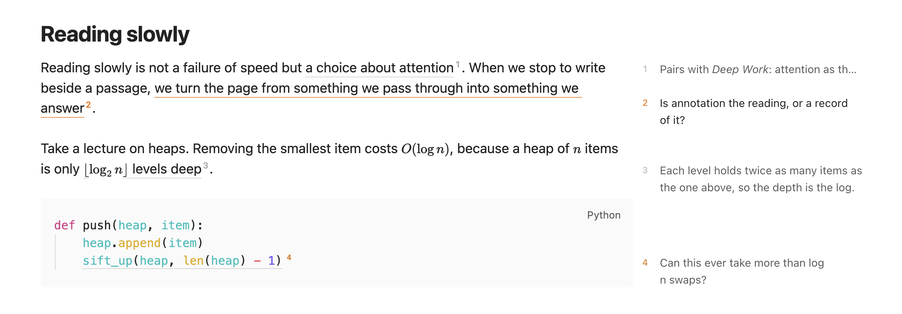

<p align="center">
  <picture>
    <source media="(prefers-color-scheme: dark)" srcset="assets/logo-dark.svg">
    
  </picture>
</p>

<p align="center"><em>Notes and questions in the margin of anything you read or write in Obsidian.</em></p>

<p align="center">
  <picture>
    <source media="(prefers-color-scheme: dark)" srcset="assets/screenshot-dark.png">
    
  </picture>
</p>

Select a passage and run **Add note**. Your text is never touched: notes live in a plain section at the end of the file, so they read fine in any editor.

```markdown
<!-- marginalia -->
---

## Notes

> the ability to focus without distraction

Why a skill and not a trait?
```

## License

[MIT](LICENSE). The logo is set in [UnifrakturMaguntia](https://fonts.google.com/specimen/UnifrakturMaguntia) (SIL Open Font License 1.1).
